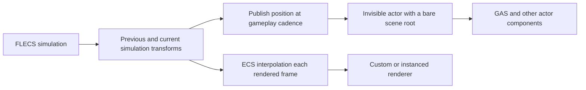

# Movement Benchmark

MovementBenchmark measures the cost of simulating movement in FLECS and synchronizing that movement to Unreal actors. See [benchmark results](RECORDS.md) and [capture instructions](Source/MovementBenchmarkUncooked/README.md).

## Conclusion

**Keep the authoritative simulation transform and the frame-rate interpolated pose in ECS.** Treat each Unreal actor as a gameplay proxy with the minimum transform state its components and consumers require. The actor update rate and the presentation update rate can then be chosen independently.

1. **Keep a bare scene root when gameplay needs an Unreal world transform.** If a Gameplay Ability System (GAS) ability or another actor component reads the actor pose for targeting, range checks, or spatial queries, use a movable `USceneComponent` root. For the benchmark's eligible bare roots, use the guarded `SetWorldLocationAndRotationNoPhysics` path. It updates the actor's world transform and preserves normal transform propagation. In the same-build comparison, it reduced mean sync callback time by **12.3%** compared with the legacy setter.
2. **Publish the gameplay proxy transform at the cadence its consumers require.** An invisible actor that hosts gameplay components can receive ECS position updates at a lower fixed rate or at gameplay boundaries. If a consumer needs a fresh world position for an ability or query, publish the current ECS position before that operation. Apply the initial pose and the final position when movement stops.
3. **Sync only the transform channels the actor consumes.** For position-only consumers, omit rotation reads, comparisons, and writes. If ECS owns the published position, track position changes with a dirty flag or revision and skip unchanged writes. Continue using the scene-root eligibility checks before taking the no-physics path.
4. **Render from ECS poses through a separate presentation path.** A custom renderer or instanced rendering system can read interpolated poses from ECS each rendered frame. The gameplay proxy can stay invisible and update at the rate gameplay requires.
5. **Interpolate in ECS from simulation snapshots.** Advance authoritative movement on the simulation clock, then derive a presentation pose from the previous and current snapshots at render time. Publish the authoritative position to gameplay proxies when needed and send the interpolated pose to the renderer.

